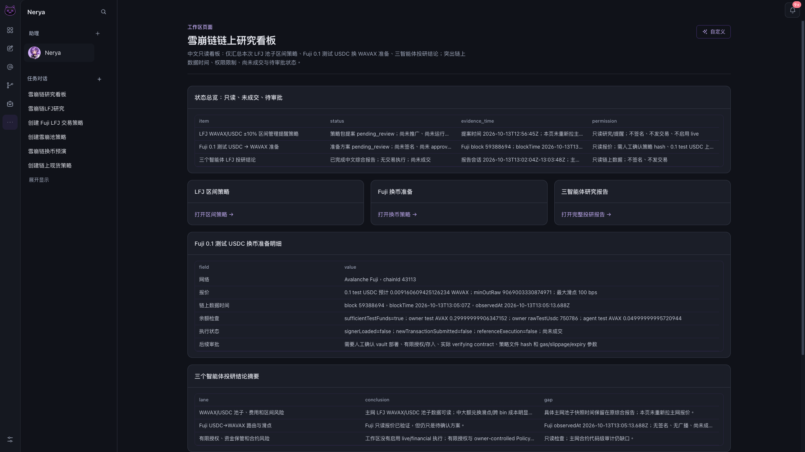

# Nerya · Avalanche

中文优先的 Avalanche 量化智能体工作台：用对话创建策略，让专业智能体并行投研，再把验证结果整理成可检查的报告与看板。

这是独立、干净初始历史的 Avalanche 版本，源自 Nerya 主项目与比赛分支的同步快照（2026-10-13）。底层通用运行时保留多市场能力；本仓库的演示入口与资料聚焦 Avalanche。

## 中文演示与 Pitch

- [新版两分钟 4K 中文链上 demo + 原速完整对话](https://github.com/NeryaAI/Nerya-Avalanche/releases/tag/demo-20261013-onchain-v3)：重新录制中文 UI、自然语言需求、LFJ 池子策略、Fuji 链上换币准备、三智能体投研和看板创建；MiMo v2.5 TTS 白桦旁白、现成 Future Forward 音乐、内嵌中文字幕。短版保留四次初始输入和完整最终回复，仅加速执行等待；原速长版另保留两轮看板修正与应用过程。
- 旧版保留：[MiMo v2](https://github.com/NeryaAI/Nerya-Avalanche/releases/tag/demo-20261013-mimo-v2) / [v1](https://github.com/NeryaAI/Nerya-Avalanche/releases/tag/demo-20261013)。旧版界面为英文，含交易所行情回放，不作为新版链上能力的证明。
- [十页可编辑中文 Pitch Deck](media/Nerya-Avalanche-Pitch-ZH.pptx) / [PDF](media/Nerya-Avalanche-Pitch-ZH.pdf)，含中文讲稿。保留最新 Solana 中文 deck 的原生版式，替换 Avalanche 场景。
- [新版中文字幕](media/nerya-avax-natural-onchain-zh.srt) / [录制说明](media/onchain-demo-v3.md)。音乐素材库说明标注 AI-generated and rights-cleared，未独立审计。音频和字幕已做自动验收，不声称真人试听。



## 展示内容与边界

| 工作流 | 本次真实展示 | 当前限制 |
| --- | --- | --- |
| LFJ LP 池策略 | 中文自然语言创建 $1,000 预算、±10% 区间管理提醒；读取真实 Avalanche LFJ 池并静态验证 | 观察模式；未添加/移除流动性；历史数据缺口如实保留，不以 CEX 行情填充 |
| Fuji 链上现货策略 | 中文创建 0.1 测试 USDC→WAVAX 策略；真实 DEX 路由报价、1% 滑点和有限权限准备 | 未签名、approve、入金或交换；报价不是成交；新提案不混用先前提案已部署 Vault |
| 多智能体投研 | 池子/费用、链上路由、授权/资金风险三个成员完成任务，Lead 汇总完整报告 | Fuji 成员因缺有效提案绑定而未取得报价；报告保留缺口。看板后来补充的报价不冒充成员结果 |
| 看板创建 | 自然语言生成候选，两轮纠正，实际审批应用，并验证三个原生链接 | 操作人员校正原生链接 schema、内部 revision 与全宽布局；不是无人干预一次成功。表头仍为英文安全 key |

自进化、复盘与审批是通用运行时机制。本次 demo 不声称已经完成自主持续交易。仓库中的旧 Fuji 链上回执属于独立历史参考，不属于本次新建策略；本次未发送交易。Vault 页面说明凭据保护，不等于资产托管审计。会员、x402、A2A 和 ERC-8004 页面标为未来规划。

## 本地安装

需要 Python 3.11+、Node.js 22–26、npm。所有依赖与状态保持在本仓库本地。

```bash
git clone https://github.com/NeryaAI/Nerya-Avalanche.git
cd Nerya-Avalanche
python3 -m venv .venv-competition
source .venv-competition/bin/activate
python -m pip install -e '.[dev,mcp,trading]'
npm ci
npm --prefix competition/avalanche ci
```

先在你自己的 Nerya 工作区中配置真实模型。启动时显式传入该工作区绝对路径；启动器只读取模型配置和模型凭据，不复制交易账户、钱包、会话或调度。不要在仓库提交 API key 或工作区状态。

```bash
python competition/avalanche/scripts/start.py --model-source /absolute/path/to/your-model-workspace
```

UI：`http://127.0.0.1:18480/chat`，API：`127.0.0.1:18417`。若端口被占用，启动器退出，不会关闭已有服务。隔离状态在 `competition/avalanche/.runtime/`，真实交易关闭；无真实模型时不以 mock 替代。中文界面可在语言设置中选择。

此包装使用了受限的模型提供者白名单，详见 `competition/avalanche/scripts/native_runtime.py`；不支持的提供者会明确拒绝，需先配置受支持的 provider。

## 验证

```bash
python -m pytest -m '' -q competition/avalanche/tests_native tests/test_candidate_bundle_runtime_state.py
node --test dashboard/tests/competition-chinese.test.cjs dashboard/tests/execution-flow.test.cjs dashboard/tests/approval-resolution.test.cjs
npm run typecheck --workspace @nerya/dashboard -- --incremental false
```

本次干净快照的 Python 检查为 41 通过、2 跳过，前端定向检查 22 通过，TypeScript 检查通过。测试、历史纸面回放、Fuji 历史参考与主网实盘是不同的证据层级，不能互相替代。复现策略输出需要真实模型与当时可获取的数据，结果不保证相同。

本仓库保留同步来源的依赖版本；安装时 npm 对 Next.js 14.2.15 提示已知安全风险。此交付未做依赖安全升级或生产部署，请勿未经安全评估直接用于公网生产。

## 结构

- `nerya/`：Agent、策略、风险、凭据和研究运行时。
- `dashboard/`：原生对话、策略、回放、多智能体、工作区和看板。
- `competition/avalanche/`：隔离启动器、技能、只读市场/回执工具、测试与合约实验代码。
- `sdk/`、`workspace_template/`：SDK 与工作区模板。
- `media/`：本次中文公开资料；大视频放 GitHub Release，不进入 Git。

合约和工具不是安全审计报告。主网 43114 只允许公开只读市场观察，比赛执行边界为 testnet；不得把 local EVM 测试夹具标为 Fuji。

## 来源与许可证

原项目：[NeryaAI/Nerya](https://github.com/NeryaAI/Nerya)。本快照已同步主项目提交 `0710c579706040f1176d2b32993937a53b8efa96`；Avalanche 合并点为 `9b4fc7a421be9ed02bc8dd175e9c75df773c7eac`，并包含录制发现的运行态 SQLite 候选修订修复。原许可证保持于 [LICENSE](LICENSE)。
